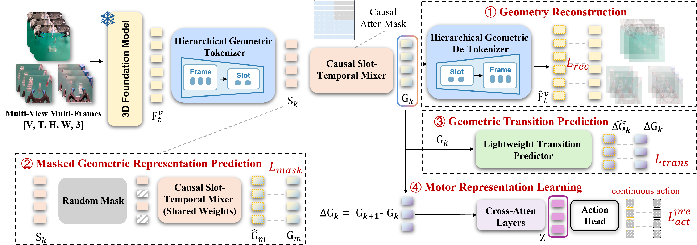

<br>
<p align="center">
  <h1 align="center"><strong>From Predictive Geometry to Action: Learning Complementary Predictive Representations for Embodied Manipulation</strong></h1>
  <p align="center">
    Xiaoxu Xu, Hao Li, Hongtao Zhang, Yili Tang, Jiafei Cao, Junhao Cai, Haoxiang Ma, Weixin Li, Weinan Zhang
    <br>
    Beihang University, Shanghai AI Laboratory
    <br>
  </p>
</p>

<div id="top" align="center">

[](http://arxiv.org/abs/2610.28164)
<!-- [](https://xuxiaoxxxx.github.io/projects/futurevla/) -->

</div>


## Abstract <a name="highlight"></a>

Effective manipulation requires a policy to capture not only about the current scene geometry, but also about how that geometry will evolve under interaction. Existing approaches either augment policies with geometric information from current observations or introduce future prediction as auxiliary supervision, leaving open how predictive geometry should be represented for action generation. 

Therefore, we propose a two-stage framework, which learns complementary predictive representations from multi-view video clips. During pretraining, a frozen 3D foundation model provides dense geometric features that are compressed into predictive geometric representations and optimized to preserve scene structure and its temporal evolution. Action supervision is then applied to geometric transitions to extract a complementary motor representation that emphasizes action-relevant transitions. During downstream post-training, predictive geometry is transferred through geometry queries, while the motor representation guides intermediate features along the action-generation pathway. Future observations are used only as privileged supervision during training and are not required at inference time. 

Across LIBERO, LIBERO-Plus, SimplerEnv, and real-world bimanual and single-arm tasks, our approach consistently improves downstream policies, including an absolute gain of 10.4 percentage points on the WidowX evaluation. We further demonstrate transfer across multiple VLA architectures and WAMs, with improvements in both future-world and action prediction.

<div align="center">
    
</div>

<!-- ## 📢 The code will be released after the paper is accepted. Stay tuned! -->

## 🔗 Citation
If you find our research helpful, please consider citing

```bibtex
@article{xu2026cpr,
  title={From Predictive Geometry to Action: Learning Complementary Predictive Representations for Embodied Manipulation},
  author={Xiaoxu Xu, Hao Li, Hongtao Zhang, Yili Tang, Jiafei Cao, Junhao Cai, Haoxiang Ma, Weixin Li and Weinan Zhang},
  journal={arXiv preprint arXiv:2610.28164},
  year={2026}
}
```
